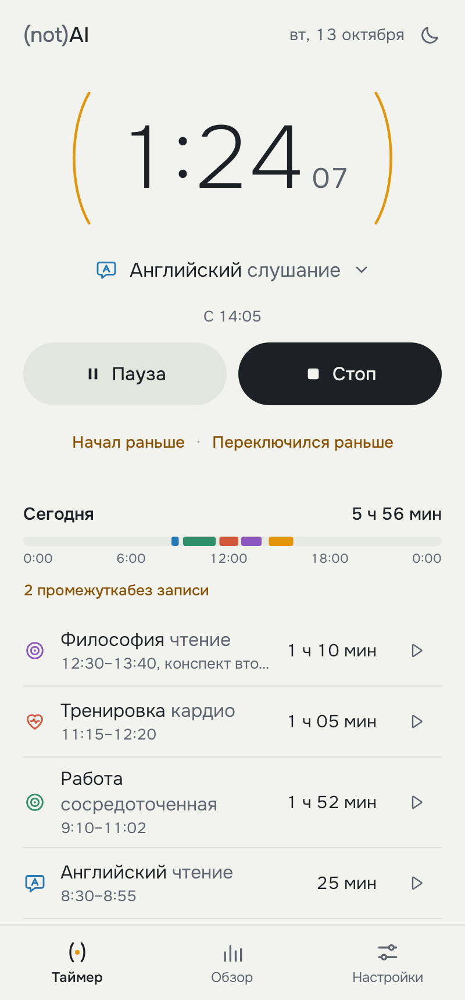

# Интерфейс

Основной интерфейс Android 0.11.0 написан на Jetpack Compose (`app/src/main/kotlin/dev/notai/tracker/android/ui`). Он не хранит и не вычисляет учётные данные: все изменения идут через `Tracker`, длительности и итоги берутся из снимков и отчётов ядра, команды получают `Token` или `TimerTarget` из показанного состояния. Контракт — [UI_CONTRACT](UI_CONTRACT.md).



## Визуальный язык (not)AI

**Интервал.** Знак линейки — скобки из названия «(not)AI». Время учёта стоит между двумя тонкими скобками:

| Состояние | Скобки |
|---|---|
| Покой | пустая пара вокруг «Начать» |
| Учёт идёт | янтарные, медленно «дышат» (цикл 4,2 с) |
| Пауза | серые, неподвижны; цифры приглушены |
| Время неизвестно | правая скобка пунктирная: интервал открыт, пока человек не укажет конец |

При старте скобки раскрываются от центра (пружина, около 600 мс). Других постоянных анимаций нет. Если в системе выключены анимации (`ANIMATOR_DURATION_SCALE = 0`), дыхание и входные движения отключаются.

**Цвет.** Янтарный означает только одно: время идёт сейчас. Остальное — бумага, чернила и графит.

| Токен | Светлая | Тёмная |
|---|---|---|
| paper | `#F2F3EF` | `#11161E` |
| raised | `#FBFBF8` | `#19212C` |
| sunk | `#E7E9E3` | `#0B0F15` |
| tonal | `#E3E6DF` | `#232C38` |
| ink | `#1D2024` | `#ECEAE4` |
| ink2 | `#5E646E` | `#A3ABB7` |
| rule | `#DCDFD8` | `#27303D` |
| amber | `#E39508` | `#FFB23C` |
| amberInk (ссылки) | `#8A5200` | `#FFC266` |

Области занятий имеют шесть цветов в фиксированном порядке: работа, языки, движение, учёба, чтение и письмо, досуг и творчество. Быт, сон, еда, дорога и свои занятия без области — нейтральный серый. Палитра проверена валидатором на различимость соседних цветов, в том числе при дальтонизме, в обеих темах. Сопоставление корня каталога с цветом — `Areas.slot` в `Presentation.kt`; на данные оно не влияет.

**Иконки занятий.** 65 линейных иконок на сетке 24 (штрих 1,7, скруглённые концы) окрашены в цвет области. Источник один — `scripts/activity_icons.py`: он пишет `res/drawable/act_*.xml` и словарь `ActivityGlyphs.kt` и проверяет, что каждый из 1918 типов каталога получает иконку. Ключи — семантические ключи ядра `ActivityIcons.resolve` (`type:<id>:v<meaningVersion>`, затем родители): если смысл типа изменится, ключ перестанет совпадать и иконка честно откатится к родителю. Карточка без типа — кольцо с точкой, «без занятия» — пунктирное кольцо янтарными чернилами. Те же drawables используют уведомление, виджет и плавающая кнопка.

```sh
python3 scripts/activity_icons.py --check            # все типы каталога получают иконку
python3 scripts/activity_icons.py --write            # drawables и ActivityGlyphs.kt
python3 scripts/activity_icons.py --preview out.png  # лист иконок (нужен cairosvg)
```

**Иконка приложения.** Те же скобки, чуть шире, внутри — янтарные стрелки около 12:08 с точкой оси: лёгкая «галочка», которая читается как часы. Монохромный слой для тематических иконок Android 13+, белый знак для строки состояния (`ic_stat_notai`), ярлык на тёмном круге. Источник — `scripts/app_icon.py` (`--preview out.png` рисует маски разных лаунчеров).

**Шрифт.** Onest (SIL OFL 1.1, лицензия в `assets/licenses/onest-OFL.txt`), пять начертаний в APK. Везде табличные цифры (`tnum`), поэтому таймер не дрожит. Таймер — 76 sp ExtraLight, секунды — отдельно 24 sp.

## Экраны и вызовы ядра

| Экран | Что видит человек | Вызовы |
|---|---|---|
| Таймер, покой | «( Начать )», быстрый старт из избранного и недавних, Focus | `start`, `startFavorite`, `repeat`, `startFocus` |
| Таймер, учёт | Цифры в скобках, занятие или «Без занятия: выбрать», Пауза/Стоп, «Забыл переключиться?» | `timerCommand` по `TimerTarget`, `labelCurrent`, `switch`, `switchedEarlier` |
| Выбор занятия | Недавние, избранное, области каталога с вложенностью, поиск, создание своего | `ChoiceView.suggestions/search`, `saveCard`, `saveFavorite`, `removeFavorite`, `startDraft` |
| История | Дни с итогом и лентой 0–24, записи, повтор, «Добавить запись задним числом» | `TrackerView.calendar`, `repeat`/`switch`, `manual` |
| Исправление | Занятие, начало и конец (±5 мин или циферблат), заметка, мини-лента с соседями, итог дня «было → станет» | `previewCorrection` → `applyCorrection` |
| Время неизвестно | Открытый интервал от известного начала | `resolveTail` / `resolveFocus` |
| Focus | Обратный отсчёт в скобках, полоса фазы, Пауза/Завершить, пропуск отрезка | `timerCommand`, `focusNext`, `focusSkip` |
| Обзор | День / 7 дней / 30 дней, столбики по дням и областям, сравнение с прошлым периодом, цели | `calendar`, `report().byType()`, `Reports.compareCalendarDays`, `goalProgress` |
| Удаление записи | Долгое нажатие → «Удалить», корзина в шапке исправления, смахивание влево. Запись из одного отрезка удаляется сразу с «Отменить»; если отрезков несколько или есть измерения — одно подтверждение со временем и составом | `previewDeleteSession` → `applyDeleteSession`, `undo` |
| Настройки | Таймер вне приложения (уведомление, плавающая кнопка, виджет, сигнал Фокуса) с честным состоянием и кнопкой действия, длительности Фокуса, тема, часовой пояс, копия, CSV, каталог, техническая оболочка | `SurfaceSettingsBackend.read` (`capabilities`), `setSurfaceEnabled`, `requestWidgetPlacement`, `configureFocus`, `ExportOperations`, `Backups`, `CatalogImports` |
| Быстрый выбор из уведомления | «Все занятия» в шторке открывает короткий список: избранное и частое за 30 дней | `SurfaceChoices.route/read/choose` |

После команд с одношаговой Undo показывается «Отменить». Текст, присланный через «Выделить → (not)AI Time Tracker», становится заметкой новой записи; ничего не сохраняется без выбора.

Решения, которые стоит знать:

- «Не учитывать» для неизвестного хвоста вызывает `resolveTail(null, null)`. Ядро удаляет весь открытый отрезок с его начала, поэтому кнопка называется «Не учитывать с 14:05».
- Итог дня включает идущую запись. Лента дня пересчитывается по ревизиям и раз в минуту, пока сессия открыта; секунды тикают только в снимке таймера.
- Область каталога с вложенными занятиями сначала раскрывается, сама область остаётся доступной строкой «Вся область».
- «Сохранить» в исправлении активна только для предпросмотра того, что сейчас на экране: любое изменение формы его сбрасывает до пересчёта.
- Удаление не спрашивает подтверждения для простой записи: Undo надёжнее диалога. Спрашивает, только когда вместе с записью уйдёт больше, чем видно в строке (несколько отрезков между паузами, измерения).
- Запись «без занятия» не попадает в быстрые варианты нигде: «начать без занятия» — это и так главная кнопка.
- Первый запуск не показывает пустых секций: без избранного и истории вместо «Начать сразу» одна кнопка «Начать с занятием», вместо пустой ленты дня — короткая подсказка, «Показать раньше» появляется только когда есть более ранние записи. Пустой обзор — одна спокойная строка вместо пустого графика.
- «Сегодня» в формах и настройках берётся из часов ядра, а не из календаря телефона.
- Тактильный отклик только там, где он что-то значит: подтверждение на старт и стоп, переключение на паузу и продолжение, щелчок, когда смахивание дошло до порога удаления.

## Таймер вне приложения

**Уведомление** (`SurfaceViews`, `DecoratedCustomViewStyle`). Свёрнутое: иконка занятия, название, живое время (`Chronometer`, без ежесекундных обновлений), пауза и главная кнопка старт/стоп — видны без раскрытия. Развёрнутое добавляет до четырёх быстрых вариантов: «Начать сразу» в покое и «Переключиться на» во время учёта, плюс «Все занятия». Нажатие на вариант применяется в фоне через `QuickChoiceReceiver` → `SurfaceChoices.choose` с маршрутом, где записана цель таймера, которую человек видел; повторное или запоздалое нажатие получает `STALE`, а не второе переключение. Во время Фокуса и «времени неизвестно» вариантов нет. Цвета следуют системной теме, канал «Таймер в шторке» — низкой важности.

**Виджет** — та же строка на поверхности (not)AI. Включение в настройках вызывает системный запрос `requestPinAppWidget`; состояние размещения (на экране, ждёт подтверждения, не появился, рабочий стол не умеет) берётся из реальных ID виджетов, а не из ответа лаунчера.

**Плавающая кнопка.** Полупрозрачный тёмный круг 44 dp со скобками: ▶ в покое, ■ с янтарными скобками, пока идёт время. Перетаскивается и прилипает к ближайшему краю, место запоминается. Одно действие — `TimerSurfaces.overlayPrimary`: старт или стоп. После стопа ядро сохраняет время и выдаёт квитанцию (`stopForAssignment`); если у записи не было занятия, снизу появляется карточка «Чем ты был занят?» с шестью вариантами. Выбор подписывает только эту остановленную запись (`assignStopped`); «Оставить без занятия» и тайм-аут 30 с закрывают квитанцию, время остаётся. Если у записи уже было занятие, карточка не показывается. Обязательный системный индикатор сервиса живёт в отдельном канале минимальной важности.

## Проверка отрисовки

```sh
./gradlew :app:testDebugUnitTest --tests 'dev.notai.tracker.android.ui.UiScreensTest' -PuiScreenshots=true
```

`UiScreensTest` строит настоящий `Tracker` в памяти с фиксированными часами, проводит его через тот же view model и рисует состояния в обеих темах в `docs/ui/screens`: таймер, выбор, исправление, Фокус, обзор, настройки, «время неизвестно», меню записи, подтверждение удаления, быстрый выбор, уведомление и виджет (настоящие RemoteViews из ресурсов, без системной шапки шторки) и плавающую кнопку. Отдельные проверки: удаление меню и смахиванием, подтверждение для записи с паузой, крупный шрифт 150 % на 320 dp (время и кнопки не теряют символов, пары кнопок встают в столбик). Без `-PuiScreenshots=true` тест только проверяет, что состояния собираются с реальными данными. Это JVM-отрисовка (Robolectric, native graphics), а не проверка на физическом устройстве.

## Холодный старт

`MainActivity` ставит те же debug-маркеры, что техническая оболочка (`activity-create`, `action-ready`, `action-first-frame`), поэтому `scripts/android_startup_samples.py` работает без изменений. `action-ready` — первая композиция с живыми кнопками таймера, `action-first-frame` — её кадр. Пока ядро загружает историю, виден экран-заставка со скобками; ни одна команда до этого недоступна. Цифры в [PERFORMANCE_QA](PERFORMANCE_QA.md) сняты на технической оболочке; для Compose-экрана их нужно снять заново на том же AVD.

## Открыто

- Проверка на телефоне: жесты, системные шторки, TalkBack, крупный шрифт, производительность, холодный старт Compose-экрана на больших историях.
- Уведомление, виджет и плавающая кнопка не проверялись на настоящих оболочках производителей: высота развёрнутого уведомления, подтверждение виджета лаунчером, перетаскивание поверх приложений.
- Иконку для своей карточки пока нельзя выбрать вручную: она берётся от типа каталога.
- Экраны для правки целей, CSV mapping, измерений, календарных вхождений и разбора конфликтов каталога. Пока это техническая оболочка.
- Открытые шторки не переживают поворот экрана: форма закрывается без записи.
- Виджет и уведомление — RemoteViews: без анимации и без шрифта Onest; виджет пока одной высоты (4×1).
- Раскладка для планшетов и горизонтальной ориентации отдельно не проектировалась.
